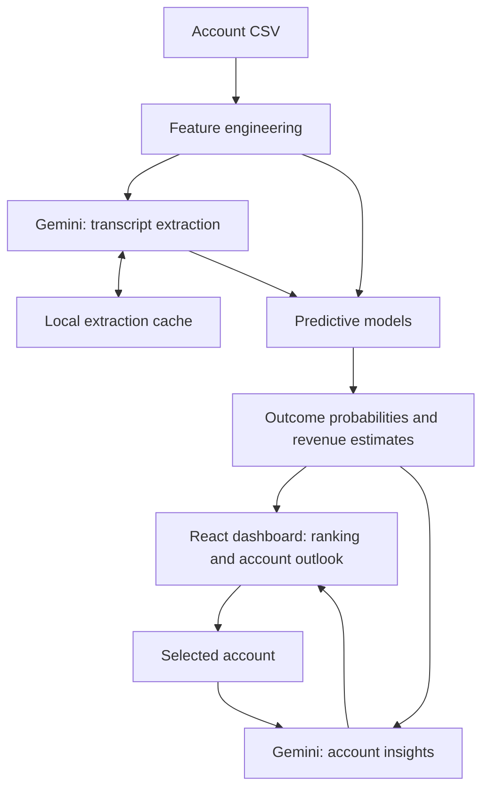

# Account Intelligence

An AI-powered application helping B2B SaaS Account Executives identify **which accounts deserve attention and why**.

The application combines predictive modeling with AI-generated account insights to assess retention and expansion opportunities, estimate the potential value of sales engagement, and recommend next steps.

## Setup and installation

### Prerequisites

- Python 3.12
- Node.js 24 (with npm)
- Git
- A [Google Gemini API key](https://aistudio.google.com/apikey)

**Windows**

Install [Python 3.12](https://www.python.org/downloads/) and [Node.js](https://nodejs.org/) using their official installers.

Install `uv` in PowerShell:

```powershell
py -3.12 -m pip install uv
```

**macOS**

Install [Python 3.12](https://www.python.org/downloads/) and [Node.js](https://nodejs.org/) using their official installers. Ensure Git is available (`xcode-select --install` if necessary).

Install `uv`:

```bash
python3.12 -m pip install uv
```

Ensure `uv`, `npm`, and `git` are available on your PATH before proceeding.

### Install dependencies

On either platform, run:

```bash
git clone https://github.com/marencjusz/account-orbit-insight-compass.git
cd account-orbit-insight-compass

uv sync
npm ci
```

Create a `.env` file in the repository root containing:

```dotenv
GEMINI_API_KEY=your_api_key_here
```

### Run

From the repository root:

```bash
uv run python run.py
```

Open **http://127.0.0.1:5173**.

The launcher starts both the React frontend and FastAPI backend, with the frontend connected to the real API.

The repository includes a pretrained model and sample dataset. To test the application, upload `data/account_data.csv` through the interface.

**Gemini and caching:** The first upload extracts structured information from account call summaries using Gemini. This may require multiple API requests and available API quota. Extractions are cached in `.cache/transcripts.json`; subsequent runs reuse them. Delete this file to regenerate extractions.

### Optional: retrain the model

The pretrained model is stored at `backend/scoring/model.joblib`. Retraining is not required to run the application.

To retrain using the provided dataset:

```bash
uv run python -m backend.train data/account_data.csv
```

This overwrites the saved model. Retraining uses Gemini for transcript extraction, reusing cached results where available.

## How it works

Upload a CSV and receive a ranked list of accounts. Rankings can be adjusted to focus on loss prevention, expansion, or expected financial benefit from additional engagement.

For each account, the application provides:

- Estimated probabilities of loss, stability, and expansion, with and without additional sales contact.
- Expected revenue under both scenarios and estimated intervention benefits.
- An AI-generated account brief explaining the commercial situation, potential intervention mechanisms, and recommended actions.

The goal is to move beyond identifying at-risk customers toward **identifying where attention could create the most value**.

## Architecture



**Backend:** Python and FastAPI handle feature preparation, scoring, and insight generation. **Frontend:** React and TypeScript provide the account dashboard and sorting interface.

The intelligence layer has two complementary parts: predictive models for numerical estimates and Gemini for understanding unstructured customer information and producing business explanations.

## Scoring approach

### Predicting account outcomes

A multinomial logistic regression predicts three possible outcomes:

- **Loss:** churn or revenue contraction.
- **Stable:** approximately unchanged revenue.
- **Expansion:** revenue growth.

The predictors combine product engagement, support activity, renewal timing, contact recency, and commercial intentions extracted from call summaries.

Separate linear regressions estimate the size of revenue changes conditional on loss or expansion. Together, these estimates provide expected account revenue.

### Estimating intervention value

Sales contact is not randomly assigned: sales teams selectively engage accounts based on their circumstances.

To partially adjust for this, the model estimates propensity scores for four contact-recency groups and uses stabilized inverse-propensity weights during training.

Intervention estimates are obtained by comparing predictions under the observed contact recency against a hypothetical contact today.

The dashboard exposes five sorting criteria:

1. Reduction in loss probability
2. Increase in expansion probability
3. Reduction in expected financial loss
4. Increase in expected financial expansion
5. Total expected revenue impact

These remain in their natural units (percentage points or dollars), rather than being converted into a composite priority score.